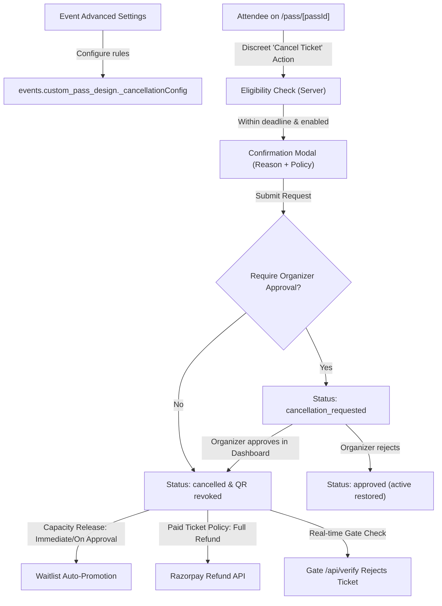

# UrPass — Ticket Cancellation Feature Audit

Date: 28 October 2026  
Scope: Repository architecture, database schemas, digital pass components, scanning infrastructure, and payment/refund integrations.

---

## 1. Executive Summary

UrPass currently contains an initial, bare-bones registration withdrawal prototype (`withdrawRegistrationAction` in `app/actions/attendees.ts` and `/booking/cancel/page.tsx`). However, it has significant architectural limitations:
1. It is hardcoded to reject all paid ticket cancellations.
2. It has no organizer configuration (no cutoff windows, approval workflows, or refund policies).
3. It directly modifies `application_status` to `'rejected'` rather than a dedicated cancellation lifecycle (`'cancellation_requested'`, `'cancelled'`).
4. It is not surfaced on the digital pass `/pass/[passId]`.
5. Gate entry and offline scanner synchronization do not have explicit cancellation revocation checks in `sync_offline_scans_bulk` or `atomic_check_in_pass`.
6. Organizers cannot view, filter, approve, or reject cancellation requests in Event → Attendees.

This audit establishes the baseline and defines the smallest compatible implementation plan to add optional, secure, attendee self-service ticket cancellations without disrupting existing ticket designs, gate speeds, or payment flows.

---

## 2. Existing vs. Missing Architectural Analysis

| Functional Area | Existing Implementation | Missing / Required Changes |
| :--- | :--- | :--- |
| **Organizer Settings** | `components/event/AdvancedFeaturesSettings.tsx` & `app/actions/event-features.ts` manage modular event feature flags and settings. | Add "Ticket Cancellation" module (`ticket_cancellation`) with settings: self-service toggle, cutoff rules, reason toggle, approval toggle, notifications toggle, capacity release policy, and refund policy. |
| **Database Schema** | `attendees` (`application_status` check allows `'pending'`, `'approved'`, `'rejected'`, `'waitlisted'`). `passes` (`status` check allows `'not_generated'`, `'generated'`, `'checked_in'`). `ticket_orders` tracks payments. | Migration 127: Expand `attendees.application_status` to include `'cancellation_requested'` and `'cancelled'`. Expand `passes.status` to include `'cancelled'` and `'revoked'`. Create `ticket_cancellations` table for audit trail, policy snapshot, reason, and refund tracking. |
| **Digital Pass UI** | `app/pass/[passId]/page.tsx` renders pass, action buttons, and QR admission stub. | Add a discreet, mobile-friendly "Cancel Ticket" trigger beneath the pass actions when eligible. Add confirmation modal with deadline, policy disclosure, and reason collection. Render "Pending Cancellation" and "Cancelled" states. Hide/disable QR for fully cancelled tickets. |
| **Transactional Backend** | `withdrawRegistrationAction` handles simple withdrawal for free tickets. | Implement `requestTicketCancellationAction`, `approveTicketCancellationAction`, and `rejectTicketCancellationAction` with server-side deadline validation, row-level locking (`SELECT ... FOR UPDATE`), idempotency, and waitlist auto-promotion. |
| **Organizer Dashboard** | `app/event/[eventId]/attendees/page.tsx` & `components/event/AttendeeTable.tsx` filter by `"all" \| "pending" \| "approved" \| "rejected" \| "waitlisted"`. | Add filter tabs for "Requests" (`cancellation_requested`) and "Cancelled". Add one-click "Approve Cancellation" and "Reject Cancellation" modals with reason and refund indicators. |
| **QR Gate Scanning** | `/api/verify` and `atomic_check_in_pass` validate tickets online. `/api/scan/manifest` and `/api/scan/sync` handle offline mode. | Ensure `/api/verify`, `mcpVerifyCheckin`, and database functions immediately reject cancelled passes with `status: 'CANCELLED'` / `ACCESS_DENIED`. In offline sync, reject any scan performed on a ticket cancelled prior to the scan. |
| **Notifications** | `lib/email.ts` (`sendAttendeeRejectionAndRefundEmail`) and `lib/communications/providers/whatsapp/templates.ts`. | Add email and WhatsApp dispatch for: cancellation requested, cancellation approved/completed, cancellation rejected, and refund status. |

---

## 3. Detailed Component Audit

### 3.1 Event Configuration & Settings Persistence
- `events.custom_pass_design`: Stores modular configurations in `_moduleConfigs.ticket_cancellation` or top-level `_cancellationConfig`.
- Server actions in `app/actions/event-features.ts`: `saveEventModuleConfig` and `updateEventFeatureFlag` already enforce permissions (`owner`, `admin`, `event_manager`) and schema validation.
- Settings structure:
  ```typescript
  export interface TicketCancellationConfig {
    enabled: boolean;
    cutoff: "before_start" | "24h" | "48h" | "custom";
    customCutoffHours?: number;
    requireReason: boolean;
    requireOrganizerApproval: boolean;
    sendNotifications: boolean;
    capacityReleasePolicy: "immediate" | "on_approval" | "never";
    paidTicketPolicy: "no_refund" | "full_refund" | "manual_review";
  }
  ```

### 3.2 Pass Authentication & Attendee Self-Service Security
- Pass access is secured by high-entropy unguessable `pass_token` (64-character hex token in `/pass/[passId]`) and `cancellation_token` in `attendees`.
- Public pass viewer in `lib/passes/public-pass.ts` validates token authenticity.
- Any cancellation request requires either:
  1. Authenticated session matching attendee email or event organizer/admin role, OR
  2. Verified `pass_token` / `cancellation_token` presented over HTTPS.
- Deadlines are evaluated strictly on the server against event start time and UTC timestamps. Frontend deadline displays are advisory only.

### 3.3 Gate Verification & Revocation Concurrency
- **Online Verification (`/api/verify`)**: Lines 978–994 check `pass.status === 'cancelled'`. We will ensure `attendee.application_status === 'cancelled'` and `'cancellation_requested'` are also evaluated before admittance.
- **Atomic Stored Procedure (`atomic_check_in_pass`)**: Add explicit guard:
  ```sql
  IF v_pass_status IN ('revoked', 'cancelled') OR v_att_app_status IN ('cancelled', 'rejected') THEN
    RETURN jsonb_build_object(
      'status', 'CANCELLED',
      'success', false,
      'accessDenied', true,
      'error', 'This ticket has been cancelled. Entry Denied.',
      'message', 'This ticket has been cancelled. Entry Denied.',
      'scanOperationId', p_scan_operation_id
    );
  END IF;
  ```
- **Offline Scanner Sync (`/api/scan/sync`)**: In the batch loop and bulk RPC, if `pass.status === 'cancelled'` or `pass.status === 'revoked'`, return `status: 'CANCELLED'` and record conflict.

### 3.4 Payment & Refund Architecture
- UrPass supports paid tickets via Razorpay (`ticket_orders` and `payment_transactions`).
- When a paid ticket is cancelled:
  - If `paidTicketPolicy === 'full_refund'`: Initiate Razorpay refund, update `ticket_orders` to `status = 'refunded'`, and log `refund_id`.
  - If `paidTicketPolicy === 'manual_review'`: Mark ticket cancelled (or pending approval), mark refund status `pending_review` in `ticket_cancellations`, and allow the organizer to issue the refund manually via the existing payout/order dashboard.
  - If `paidTicketPolicy === 'no_refund'`: Release capacity (if configured), revoke ticket, and record `refund_status = 'none'`.

---

## 4. Implementation Plan



### Steps:
1. **Migration 127**: Update constraints on `attendees` and `passes`, create `ticket_cancellations` table with audit columns and indexes.
2. **Settings**: Add "Ticket Cancellation" configuration module in `components/event/AdvancedFeaturesSettings.tsx` and persistence handlers in `app/actions/event-features.ts`.
3. **Backend Engine**: Create `lib/cancellation/service.ts` and `app/actions/ticket-cancellation.ts` with atomic concurrency, deadline enforcement, waitlist auto-promotion, and audit logging.
4. **Digital Pass UI**: Add `CancelTicketButton` and `CancelTicketModal` to `app/pass/[passId]/page.tsx`, show cancellation status badges, and hide the scannable QR when cancelled.
5. **Organizer Dashboard**: Enhance `AttendeeTable.tsx` with "Cancellation Requests" filter, request review modal (Approve/Reject), and cancellation details.
6. **QR Gate Scanner & Offline Sync**: Wire cancellation checks into `/api/verify`, `mcpVerifyCheckin`, and `app/api/scan/sync/route.ts`.
7. **Notifications**: Wire email confirmations for request, approval, rejection, and cancellation.
8. **Automated Vitest Tests**: Cover free/paid, deadline limits, scanned/unscanned, duplicate requests, offline sync revocation, and authorization checks.
